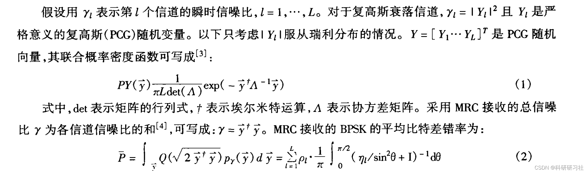
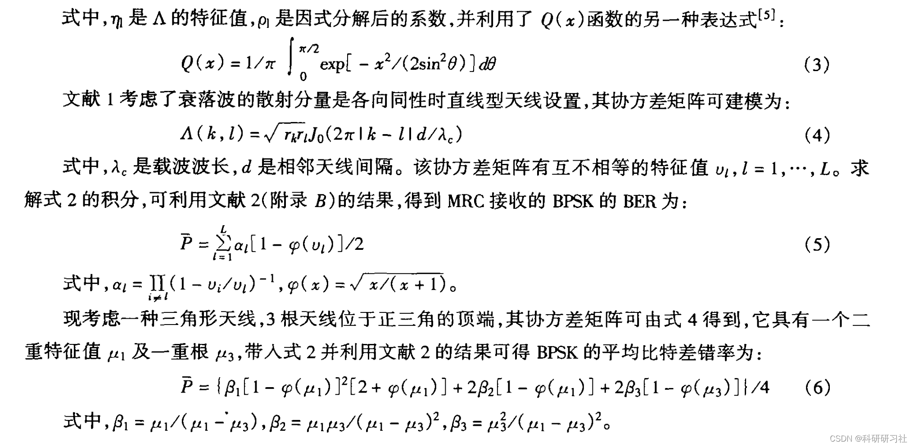
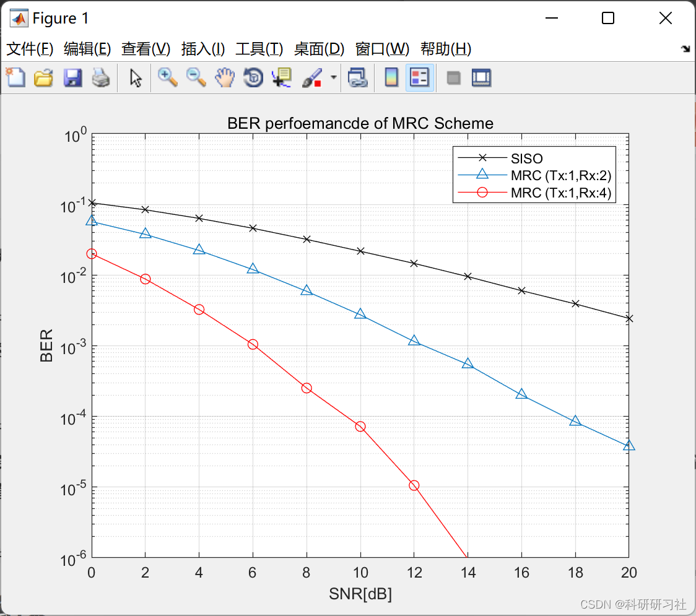

# Diversity of Antennas and Space-Time Coding Techniques - MRC Performance in Rayleigh Fading Channels (Matlab Code Implementation)

1. Overview of Diversity Combining
Diversity combining is an effective technique for combating multipath fading. The maximum ratio combining (MRC) technique can maximize the receiver's signal-to-noise ratio, thus being a best-performing combining technique. When diversity combining is employed on a multipath fading channel, if the signal undergoes correlated fading, it leads to a decrease in the achievable diversity gain and system performance. Veeravali utilized the joint distribution model of complex Gaussian envelopes to analyze the system performance of diversity receiving on correlated fading channels, providing a convenient generalized calculation method [1]. However, the paper does not provide the performance results of MQAM, a digital modulation technique with high frequency utilization. This study investigates the MRC receiving scheme with triangular antenna settings on Rayleigh fading channels, and employs another expression of Q(x) to analyze the MQAM performance using MRC.
Editor
Editor 2. Run Results
3. Matlab Code Implementation
This article only showcases part of the code; for the complete code, click the link:
Antenna Diversity and Space-Time Coding Technologies - MRC Performance under Rayleigh Fading Channels (Matlab Code Implementation)
function [mod_symbols,sym_table,M] = modulator(bitseq,b)\n\nN_bits = length(bitseq);\nif b==1      % BPSK modulation\n   sym_table=exp(j*[0 -pi]);  \n   sym_table=sym_table([1 0]+1);\n   inp=bitseq;   \n   mod_symbols=sym_table(inp+1);  \n   M=2;\n elseif b==2    % QPSK modulation\n   sym_table = exp(j*pi/4*[-3 3 1 -1]); \n   sym_table=sym_table([0 1 3 2]+1);\n   inp=reshape(bitseq,b,N_bits/b);\n   mod_symbols=sym_table([2 1]*inp+1);  \n   M=4;\n elseif b==3    % generates 8PSK symbols\n   sym_table=exp(j*pi/4*[0:7]);\n   sym_table=sym_table([0 1 3 2 6 7 5 4]+1);\n   inp=reshape(bitseq,b,N_bits/b);\n   mod_symbols=sym_table([4 2 1]*inp+1);\n   M=8;   \n elseif b==4    % 16-QAM modulation\n   m=0;  \n   sq10=sqrt(10);\n   for k=-3:2:3\n      for l=-3:2:3\n         m=m+1; s\n         ym_table(m) = (k+j*l)/sq10; % power normalization\n      end\n   end\n   sym_table = sym_table([0 1 3 2 4 5 7 6 12 13 15 14 8 9 11 10]+1); % Gray code mapping pattern for 8-PSK symbols\n   inp = reshape(bitseq,b,N_bits/b);\n   mod_symbols = sym_table([8 4 2 1]*inp+1);  % maps transmitted bits into 16QAM symbols\n   M=16; %16 constellation points\n else\n   error('Unimplemented modulation');\nend\n\n\n  
🎓 Bloggers' Extracurricular Interests: Eastern and Western Philosophy, to be given to readers: 👨‍💻 Doing research involves a profound philosophical system that requires researchers to be logically precise and diligent. However, it is not just about effort; sometimes, leveraging others' efforts can be more important. Additionally, there should be an innovative point and inspiration in looking up at the stars. When philosophy teachers ask you what science is or what electricity is during class, do not think these questions are funny. Philosophy seeks ultimate questions, seeking those questions that only children ask but you cannot answer. In this column, I record some philosophical thoughts and scientific notes when I have time: Scientific Research and Philosophical Thoughts. It is recommended that readers read the articles in order according to the directory, so as not to suddenly fall into a dark labyrinth without knowing how to get back. It may not reveal all the answers to your questions, but if it can raise doubts in your mind, it might also lead to a different scenery of colorful sunsets. If it brings you a heavy rain in the spiritual world, then take this opportunity to wash away the dust on the "truth" you previously stored there.
Maybe, after the rain, the clear sky of the universe will become even clearer...🔎🔎🔎4 References
[1] Li Guangqiu, Cao Xiaobo. Performance Analysis of MQAM with Combinatorial Transmitters SC/Receivers MRC in Rayleigh Fading Channels [J]. Journal of Electronics, 2003, 31(7):1080-1082
[2] Xu Jun. Performance Analysis of MRC Receiver in Correlated Rayleigh Fading Channels [J]. Hangzhou University of Science and Technology Journal, 2003, 23(6):43-46

## Images

<!-- PAYMENT_BLOCK -->

## Get this dataset

- Payment link (Stripe): [Buy now](https://buy.stripe.com/3cs8yP7sY87d0vu9AB)
- Payment QR code: 

<!-- /PAYMENT_BLOCK -->
